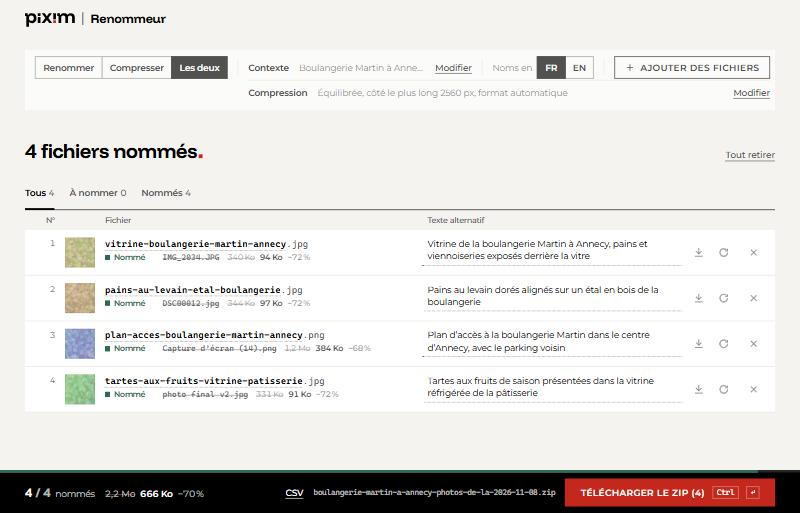

# Renommeur

[](https://github.com/HassanNdam/renommeur/actions/workflows/ci.yml)

**Des noms de fichiers propres pour le web, en un glisser-déposer.**

`IMG_2034.JPG` → `vitrine-boulangerie-martin-annecy.jpg`

Le Renommeur est une application web conçue pour l'équipe d'une agence web, Pixim. Les visuels et documents fournis par les clients arrivent avec des noms inutilisables (`IMG_2034.JPG`, `DSC00012.jpg`, `Capture d'écran (14).png`) et partent tels quels sur les sites : mauvais pour le référencement, et sans texte alternatif pour l'accessibilité.

On dépose un lot de fichiers ; un modèle de vision (API Claude) propose pour chacun un nom optimisé pour le référencement et, pour les images, un texte alternatif. On relit, on corrige au besoin, puis on récupère un ZIP prêt à publier. Les images peuvent aussi être compressées, directement dans le navigateur.



## Fonctionnalités

- **Renommage SEO** d'images, PDF, Word, Excel, PowerPoint, vidéos et fichiers texte, en français ou en anglais, guidé par un contexte libre (client, lieu, sujet).
- **Textes alternatifs** de 60 à 125 caractères pour les images et les vidéos.
- **Relecture** : chaque nom et chaque texte alternatif reste modifiable, et un fichier peut être renommé à nouveau.
- **Compression des images** dans le navigateur (MozJPEG, WebP, PNG quantifié), avec trois niveaux, une taille maximale et un choix de format.
- **Trois traitements** : renommer, compresser, ou les deux.
- **Export** en ZIP, fichier par fichier, ou table de correspondance en CSV ; en compression seule, le ZIP garde l’arborescence des dossiers déposés pour écraser les fichiers en place.
- **Glisser-déposer** de fichiers ou de dossiers entiers ; doublons et fichiers système ignorés.

## Points techniques

- **Confidentialité par conception.** Les fichiers ne quittent jamais le poste. Seule une vignette de 768 px ou un extrait de texte part vers l'API ; rien n'est stocké sur le serveur. La compression et la création du ZIP se font entièrement côté client.
- **Compression WebAssembly en parallèle.** Un pool de Web Workers (2 ou 3 selon la mémoire du poste) encode avec des codecs WASM chargés à la demande, avec un budget mémoire en mégapixels, un délai maximal par image et un repli sur l'encodeur natif du navigateur si WebAssembly est bloqué.
- **Files de travail concurrentes.** Lecture (3 fichiers à la fois), nommage (3 lots de 8 en parallèle, découpés aussi selon leur poids) et compression avancent indépendamment, avec relance automatique et pause croissante en cas d'erreur passagère.
- **ZIP en flux.** L'archive s'écrit au fil des résultats, directement sur le disque dans Chrome et Edge (File System Access API) : pas de limite pratique de taille.
- **Sortie structurée et règles déterministes.** Le modèle répond selon un schéma JSON imposé ; le format final des noms (minuscules, sans accents, 70 caractères au plus, doublons numérotés sans tenir compte de la casse) est appliqué par le code et couvert par des tests.
- **Métadonnées retirées** (EXIF, position GPS) des images compressées, par lecture directe des en-têtes JPEG, PNG et WebP.
- **Hébergement mutualisé.** API PHP sans framework, requêtes courtes et sans état : pas de file d'attente, pas de tâche planifiée, pas de dépassement du délai PHP. En-têtes CSP stricts (`script-src 'self' 'wasm-unsafe-eval'`).

## Stack

| Côté | Technologies |
|---|---|
| Interface | Svelte 5 (runes), TypeScript, Vite |
| Images | `@jsquash` (MozJPEG, libwebp, oxipng), libimagequant, pdf.js, Web Workers |
| Archive | client-zip, fflate |
| API | PHP 8.1+, SDK PHP Anthropic, Guzzle |
| Qualité | Vitest, svelte-check, GitHub Actions |

## Architecture

```
Navigateur                                        Serveur PHP              API Claude
fichiers ─► vignette 768 px / extrait de texte
        ─► lot de 8 ─────────────────────────────► api/name.php ──────────► modèle de vision
        ◄─ { name, alt } × 8 ◄─────────────────────────────────────────────◄
format imposé (src/lib/slug.ts) ─► compression (Web Workers + WASM) ─► ZIP en flux
```

| Dossier | Rôle |
|---|---|
| `src/lib/store.svelte.ts` | État de l'application et files de lecture, de nommage et de compression |
| `src/lib/prepare.ts` | Vignettes et extraits de texte, dans le navigateur |
| `src/lib/compress/` | Moteur de compression (`worker.ts`), pool de workers, réglages, lecture des en-têtes d'images |
| `src/lib/slug.ts` | Règles de nommage et numérotation des doublons |
| `src/components/` | Interface Svelte |
| `api/` | API PHP : `settings`, `ping`, `name` |
| `scripts/` | Serveur PHP de développement, fabrication du paquet de livraison, synchronisation de version |
| `dev/` | Fichiers d'essai et scénarios de test dans le navigateur |

## Démarrage rapide

Prérequis : Node 22+, PHP 8.1+ et Composer.

```bash
npm install
```

```bash
composer install --working-dir=api
```

Copier `api/config.sample.php` en `api/config.php`, puis mettre `'mock' => true` pour obtenir des noms fictifs sans clé API, ou renseigner `api_key` pour de vrais noms.

```bash
npm run dev
```

L'application s'ouvre sur http://localhost:5173. `npm run dev` démarre aussi l'API PHP (port 8090) et l'arrête avec elle.

> Derrière un antivirus ou un proxy qui inspecte le TLS, PHP et Composer ont besoin de son certificat racine : le placer dans `.tmp/ca.pem`, que `npm run api` passe automatiquement à PHP, et préfixer Composer de `COMPOSER_CAFILE=.tmp/ca.pem`.

## Scripts

| Commande | Rôle |
|---|---|
| `npm run dev` | Serveur de développement (Vite + API PHP) |
| `npm run api` | API PHP seule, sur le port 8090 |
| `npm test` | Tests unitaires (règles de nommage, en-têtes d'images, retrait des métadonnées) |
| `npm run check` | Vérification TypeScript et Svelte |
| `npm run build` | Build de production dans `dist/` |
| `npm run release` | Paquet prêt à envoyer par FTP, dans `release/` |

## Documentation

- [Compression des images](docs/compression.md) : fonctionnement, réglages, métadonnées, licences.
- [Mise en ligne, réglages et sécurité](docs/deploiement.md) : hébergement OVH, `api/config.php`, contrôles après envoi.
- [Contribuer](CONTRIBUTING.md) : git flow, messages de commit, publication d'une version.

## Limites connues

- HEIC, TIFF, PSD et RAW ne s'affichent pas dans le navigateur : ces fichiers sont nommés d'après leur nom d'origine et le contexte, et l'interface l'indique. Même chose pour les anciens `.doc`, `.xls` et `.ppt`.
- La cohérence des noms se joue à l'intérieur d'un lot de 8. D'un lot à l'autre, seuls les doublons exacts sont évités, par numérotation.
- Firefox et Safari assemblent le ZIP en mémoire : au-delà de quelques Go, mieux vaut découper le lot.
- La compression a surtout été éprouvée sous Chrome ; Firefox et Safari restent à valider sur de gros lots.

## Licences

Les composants tiers et leurs licences sont listés dans [`public/licences.txt`](public/licences.txt). Le quantificateur PNG (libimagequant) est sous GPL v3 : voir [Compression des images](docs/compression.md).
